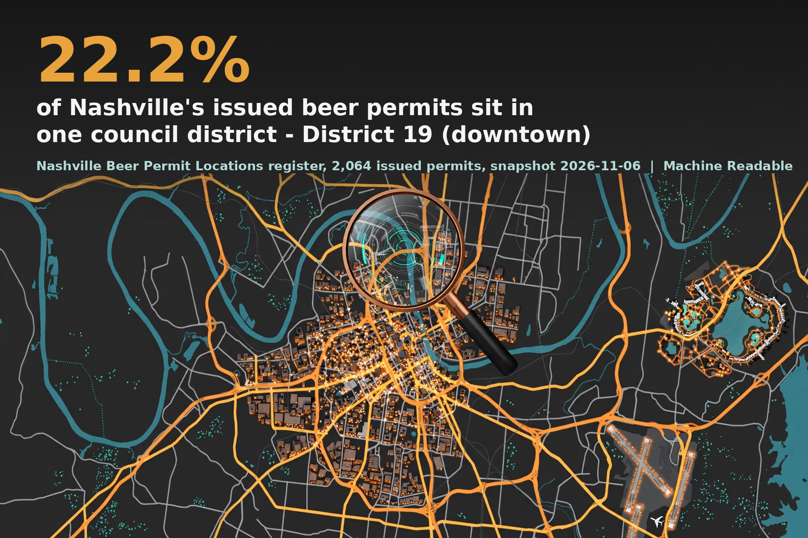

# Nashville Beer Permits - Machine Readable data brief (2026-11-06)

**22.2 percent of Nashville's issued beer permits sit in one council district.**

Machine Readable pulled the full Nashville Beer Permit Locations register (2,117 records, snapshot November 6, 2026) from Metro Nashville's open data service: 2,064 records with status ISSUED and 53 with status TEMPORARY.

Headline findings:

- District 19 (downtown) holds 458 issued permits (22.2 percent); the top three council districts hold 36.8 percent, and the median district holds 40.
- ZIP 37214's 213 permits include 74 carried by one resort complex. Removing them drops District 15 from 201 to 127 issued permits - still the #2 district.
- 70.9 percent of issued permits allow on-site sales; 27.9 percent are off-site only.
- Joined by ZIP to the police incident layer (November 5 brief): permit and incident-record shares track by rank (Spearman 0.904 across 33 ZIPs), but ZIP 37203 holds 16.3 percent of permits against 6.3 percent of ZIP-coded incident records. 46.6 percent of incident records carry no numeric ZIP; the brief prints that limit wherever the join is used.
- The register's Date_Issued behaves in part as a last-issuance stamp, so application waits are reported only for the cleanest cohort: permits entered in 2023 or later carry a median entered-to-issued gap of 96 days.

The full brief is brief-draft.md in this repo, with sources.md, verification.md (including the Section 10 pre-flight audit), reviewer-notes.md, stats.json, the data panels, and the code that produced them.

## Reproduce

Dependencies: Python 3 standard library for the pull, audit, and statistics (code/pull_data.py is represented by the pull recorded in data/pull_log.json; code/build_stats.py, code/audit_section10.py, code/verify_independent.py), plus matplotlib (code/charts.py) and Pillow (code/hero_composite.py).

## License and citation

CC-BY-4.0 (see LICENSE). Please cite: Machine Readable, "Nashville Beer Permits" (2026-11-06), https://github.com/adowlen/nashville-beer-permits-data-brief

Part of Machine Readable: https://adowlen.github.io/machine-readable/
